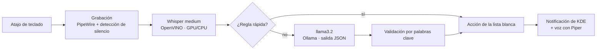

# Asistente de voz local para KDE

Asistente de voz **100 % local y offline** para Linux con KDE Plasma. Pulsas un atajo, hablas en **español o inglés**, y abre aplicaciones o proyectos, controla Docker, el volumen y la música, consulta el estado del equipo o responde preguntas. Contesta en voz alta en el mismo idioma.

Nada sale de tu equipo: la transcripción, la interpretación y la voz corren en tu CPU/GPU.



## Características

- **Bilingüe**: Whisper detecta el idioma y la respuesta usa una voz en español o en inglés.
- **Abre cualquier aplicación instalada**: lee los `.desktop` igual que el menú de KDE, incluidas las apps de Flatpak. Las herramientas de consola (`htop`, `lazygit`, `lazydocker`, `k9s`…) se abren dentro de tu terminal.
- **Rápido**: los comandos comunes se resuelven con reglas, sin pasar por el modelo de lenguaje. Solo las frases ambiguas usan el LLM.
- **Seguro**: solo puede ejecutar acciones de una lista blanca, nunca comandos arbitrarios. Además, una acción del LLM solo se acepta si la frase contiene palabras que la respalden. Si el modelo "adivina" `bloquear_pantalla` ante una frase sin sentido, se descarta.
- **Ligero en espera**: ~550 MB de RAM y 0 % de CPU mientras no lo usas.

## Comandos

| Español | English | Acción |
|---|---|---|
| "Abre kitty" / "Abre la calculadora" | "Open Firefox" / "Open MongoDB Compass" | Abre cualquier app instalada |
| "Abre htop" / "Abre lazygit" | "Open lazydocker" | Herramienta de consola en la terminal |
| "Abre el proyecto de validaciones" | "Open the billing project" | Abre el repo en VS Code (búsqueda aproximada) |
| "¿Qué contenedores tengo corriendo?" | "What containers are running?" | Lista los contenedores |
| "Levanta / detén los contenedores" | "Start / stop the containers" | `docker compose up -d` / `stop` |
| "Sube el volumen" / "Pon el volumen al 30" | "Turn up the volume" / "Set the volume to 30" | Volumen con `wpctl` |
| "Pausa la música" / "Siguiente canción" | "Pause" / "Next song" | Reproductor vía MPRIS |
| "¿Cómo está la compu?" | "How is the computer doing?" | Temperatura, RAM, disco y perfil de energía |
| "Modo rendimiento" | "Switch to performance mode" | Perfil de energía (power-profiles) |
| "Busca en internet el clima en San José" | "Search the web for Python tutorials" | Búsqueda en Firefox |
| "Bloquea la pantalla" | "Lock the screen" | Bloquea la sesión |
| "¿Qué es la inyección de dependencias?" | "What is a race condition?" | Respuesta breve hablada |

Al pulsar el atajo suena un aviso y aparece "Escuchando…". Habla, y cuando te quedes en silencio 1 segundo se procesa la frase. Si pulsas el atajo otra vez mientras escucha, corta la grabación.

## Requisitos

- Linux con **KDE Plasma 6** y **PipeWire**. Desarrollado en Fedora 44.
- **Python 3.13**. Las ruedas de OpenVINO no siempre están disponibles para la versión más reciente de Python.
- **[Ollama](https://ollama.com)** con el modelo `llama3.2`:
  ```bash
  ollama pull llama3.2
  ```
- Opcional, para **GPU Intel**:
  - Whisper en la GPU: `sudo dnf install intel-compute-runtime`
  - Ollama en la GPU integrada: añade `Environment="OLLAMA_IGPU_ENABLE=1"` con `sudo systemctl edit ollama`

Sin GPU todo funciona en la CPU, solo que más lento.

## Instalación

```bash
git clone https://github.com/frantsiles/asistente-voz.git ~/.local/share/asistente-voz
cd ~/.local/share/asistente-voz
./instalar.sh
```

El script crea el `venv`, descarga los modelos (~1 GB), crea `config.json` e instala y arranca el servicio de usuario de systemd. No necesita `sudo`.

Después asigna el atajo en **Configuración del sistema → Teclado → Atajos de teclado → Añadir nuevo → Aplicación → "Asistente de voz"**, por ejemplo `Meta+V`.

## Configuración

Edita `config.json` (no se sube al repo; parte de `config.example.json`):

| Clave | Por defecto | Descripción |
|---|---|---|
| `proyectos` | `~/Proyectos` | Carpeta con tus repos git. Sus nombres también se usan como vocabulario para Whisper |
| `compose` | — | `docker-compose.yml` que levantan/detienen los comandos de Docker |
| `terminal` | `kitty` | Terminal para las herramientas de consola |
| `apps_terminal` | `htop`, `btop`, `lazygit`… | Herramientas de consola que se pueden abrir (solo las instaladas) |
| `alias_apps` | `{}` | Nombres extra → id del `.desktop`, p. ej. `{"mongo": "com.mongodb.Compass"}` |
| `modelo_comandos` | `llama3.2` | Modelo de Ollama que interpreta los comandos |
| `modelo_preguntas` | `llama3.2` | Modelo que responde preguntas. Uno más grande responde mejor, pero tarda más |
| `hablar` | `true` | `false` = solo notificaciones, sin voz |

Después de cambiar algo:

```bash
systemctl --user restart asistente-voz
```

## Rendimiento

Medido en un Intel Core Ultra 7 255U con 32 GB de RAM y la GPU integrada Arc:

| Paso | Tiempo |
|---|---|
| Transcripción (Whisper medium, GPU) | ~1,1 s (2,7 s en CPU) |
| Comandos con regla rápida | instantáneo |
| Comandos interpretados por llama3.2 (GPU) | ~1,5–2,5 s |
| Preguntas | ~5–8 s |
| Voz (Piper) | ~0,3 s |

## Solución de problemas

**Ver qué entendió y qué hizo:**

```bash
journalctl --user -u asistente-voz -f
```

Cada comando se registra así: `«texto» [idioma] -> acción(parámetro) [voz 1.1s, intención 0.0s]`.

**Transcribe mal**: las últimas 10 grabaciones se guardan en `grabaciones/` para poder analizarlas. Lecciones aprendidas:
- La pista de vocabulario (`initial_prompt`) debe ser una **lista de términos**, no frases de ejemplo: con frases, Whisper corta las transcripciones.
- Whisper `small` se queda corto en español. `medium` es el mejor equilibrio entre precisión y velocidad.
- Errores recurrentes como "Abre" → «Ahora» se corrigen en `corregir()`.

**Transcribe basura en la GPU** (p. ej. «A P P?»): no uses `CACHE_DIR` con `WhisperPipeline` en la GPU. El modelo cargado desde la caché compilada produce salida corrupta (fallo de OpenVINO 2026.4).

**NPU**: OpenVINO detecta el NPU de Intel, pero el paquete `intel-npu-driver` de Fedora no incluye el compilador del NPU, así que la compilación falla con `ZE_RESULT_ERROR_UNSUPPORTED_FEATURE`. Cuando esté disponible, basta con poner `"NPU"` primero en `WHISPER_DISPOSITIVOS`.

## Privacidad

- Todo se procesa localmente. La única conexión de red es la descarga inicial de los modelos desde Hugging Face.
- `grabaciones/` guarda tus últimos 10 comandos de voz solo en tu equipo, para depuración, y está en `.gitignore`.

## Estructura

```
asistente.py            # el asistente (configuración, reglas, acciones)
config.example.json     # plantilla de configuración
instalar.sh             # instalación para el usuario actual
requirements.txt
systemd/                # servicio de usuario y entrada del menú (atajo)
```

## Créditos

- [OpenVINO GenAI](https://github.com/openvinotoolkit/openvino.genai) y [Whisper](https://github.com/openai/whisper): voz a texto
- [Ollama](https://ollama.com) y [Llama 3.2](https://www.llama.com): interpretación de comandos
- [Piper](https://github.com/OHF-Voice/piper1-gpl) y las voces de [rhasspy/piper-voices](https://huggingface.co/rhasspy/piper-voices): texto a voz

## Licencia

[GPL-3.0](LICENSE), la misma licencia que Piper, del que depende la síntesis de voz.
