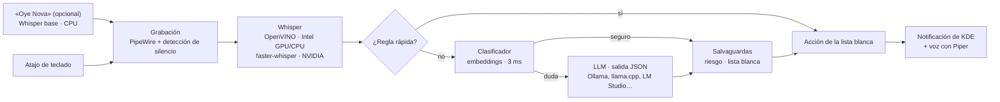

# Asistente de voz local para KDE

Asistente de voz **100 % local y offline** para Linux con KDE Plasma. Pulsas un atajo o lo llamas por su nombre (**"Oye Nova"**, opcional), hablas en **español o inglés**, y abre aplicaciones o proyectos, controla Docker, el volumen y la música, consulta el estado del equipo o responde preguntas. Contesta en voz alta en el mismo idioma.

Nada sale de tu equipo: la transcripción, la interpretación y la voz corren en tu CPU/GPU.



## Características

- **Bilingüe**: Whisper detecta el idioma y la respuesta usa una voz en español o en inglés.
- **Abre cualquier aplicación instalada**: lee los `.desktop` igual que el menú de KDE, incluidas las apps de Flatpak. Las herramientas de consola (`htop`, `lazygit`, `lazydocker`, `k9s`…) se abren dentro de tu terminal.
- **Rápido**: los comandos comunes se resuelven con reglas, sin pasar por el modelo de lenguaje. Solo las frases ambiguas usan el LLM.
- **Seguro**: solo puede ejecutar acciones de una lista blanca, nunca comandos arbitrarios. Además, una acción del LLM solo se acepta si la frase contiene palabras que la respalden. Si el modelo "adivina" `bloquear_pantalla` ante una frase sin sentido, se descarta.
- **Actualizaciones sin manejar tu contraseña**: "actualiza todo" abre la terminal con el comando de actualización; `sudo` te pide la contraseña ahí. `yay`/`paru` se ejecutan sin `sudo`, como deben.
- **Ligero en espera**: ~550 MB de RAM y 0 % de CPU mientras no lo usas.

## Comandos

| Español | English | Acción |
|---|---|---|
| "Abre kitty" / "Abre la calculadora" | "Open Firefox" / "Open MongoDB Compass" | Abre cualquier app instalada |
| "Abre htop" / "Abre lazygit" | "Open lazydocker" | Herramienta de consola en la terminal |
| "Cierra Spotify" / "Cierra la ventana" | "Close Firefox" / "Close this window" | Cierra la app como la X de la ventana (vía KWin) |
| "Maximiza" / "Manda esto a la otra pantalla" / "Escritorio 2" | "Minimize" / "Show desktop" | Ventanas y escritorios con los atajos de KWin |
| "Abre el proyecto de validaciones" | "Open the billing project" | Abre el repo en VS Code (búsqueda aproximada) |
| "Abre lazygit en validaciones" / "Abre la terminal en el proyecto X" | "Open a terminal in project X" | Terminal o lazygit en la carpeta del proyecto |
| "Estado del proyecto X" / "Último commit de X" | "Last commit of X" | Rama, cambios y commits por subir/bajar (solo lectura) |
| "Ejecuta los tests de validaciones" | "Run build backend" | Tarea de la lista `tareas` de `config.json`, en la terminal |
| "¿Qué contenedores tengo corriendo?" | "What containers are running?" | Lista los contenedores |
| "Levanta / detén los contenedores" | "Start / stop the containers" | `docker compose up -d` / `stop` (detener pide confirmación) |
| "Logs de api" / "Reinicia el contenedor mongo" | "Restart container redis" | `docker logs -f` en la terminal / `docker restart` (pide confirmación) |
| "Sube el volumen" / "Pon el volumen al 30" | "Turn up the volume" / "Set the volume to 30" | Volumen con `wpctl` |
| "Pausa la música" / "Pon música" / "Siguiente canción" | "Pause" / "Play some music" / "Next song" | Reproductor vía MPRIS (abre Spotify si no hay ninguno) |
| "Sube el brillo" / "Activa la luz nocturna" | "Brightness up" / "Turn off night light" | Brillo (PowerDevil) y luz nocturna de KWin |
| "Avísame en cinco minutos que saque la ropa" | "Set a timer for 10 minutes" | Temporizador con notificación y voz |
| "Lee / resume / traduce lo que copié" | "Summarize the clipboard" | Portapapeles de Klipper + LLM (no lee contraseñas en voz alta) |
| "Escribe hola mundo" | "Type hello world" | Copia el texto dictado al portapapeles para pegarlo con Ctrl+V |
| "Redacta un correo para mi jefe pidiendo el viernes libre" / "Escríbeme una función en Python que…" | "Write an email to the team about…" | El LLM lo escribe y lo deja en el portapapeles (Ctrl+V) |
| "Genera una imagen de un zorro en la nieve" / "Dibújame un gato astronauta" | "Draw a robot playing guitar" | [Imagen](#imágenes) con Fooocus u OpenVINO, en segundo plano; se abre al terminar |
| "¿Dónde está mi teléfono?" / "Batería del teléfono" | "Ring my phone" | KDE Connect |
| "¿Cómo está la compu?" / "Estado de la batería" | "How is the computer doing?" | Temperatura de CPU y GPU, RAM, disco, batería, red y perfil de energía |
| "¿Qué proceso usa más CPU?" / "¿Qué corre en el puerto 5000?" / "¿Hay actualizaciones?" | "Open ports" | Diagnóstico rápido del sistema |
| "Modo rendimiento" | "Switch to performance mode" | Perfil de energía (power-profiles) |
| "Busca en internet el clima en San José" | "Search the web for Python tutorials" | Búsqueda en Firefox |
| "Bloquea la pantalla" | "Lock the screen" | Bloquea la sesión |
| "Actualiza todo" / "Actualiza el sistema" | "Update everything" | Abre la terminal con la actualización del sistema |
| "Limpia la caché de paquetes" | "Clean the package cache" | Abre la terminal con `yay -Sc` / `paccache -r` / `dnf clean packages` y `flatpak uninstall --unused` |
| "Suspende / reinicia / apaga el equipo" | "Shut down the computer" | Pregunta siempre antes. Reiniciar y apagar cierran la sesión de KDE con orden |
| "¿Qué es la inyección de dependencias?" | "What is a race condition?" | Respuesta breve hablada |

Al pulsar el atajo suena un aviso y aparece "Escuchando…". Habla, y cuando te quedes en silencio 1 segundo se procesa la frase: la voz se detecta con **Silero VAD**, que la distingue de la música, y mientras escucha baja el volumen del sistema al 20 %. Si pulsas el atajo otra vez mientras escucha, corta la grabación; si lo pulsas mientras habla, se calla y vuelve a escuchar; si lo pulsas mientras procesa, avisa y te escucha al terminar.

Cada estado tiene su sonido (cámbialos en `SONIDO_ESTADO`): **escuchando** (pitido al empezar), **procesando** (clic al dejar de grabar), **éxito**, **fallo** (no entendió o falló la acción), **no escuché** (no detectó voz) y **ocupado**. Toda interacción termina con un sonido y una notificación. Las respuestas a preguntas se leen oración por oración mientras Ollama las genera.

## Palabra de activación

Opcional y desactivada por defecto: con ella el **micrófono queda abierto todo el tiempo** (KDE muestra el indicador). Actívala en `config.json`:

```json
"nombre": "Hades",
"palabra_activacion": "hades",
"umbral_activacion": 0.87
```

Responde a "Hades", "Oye Hades" y "Hey Hades" (cámbialas con `variantes_activacion`), de corrido ("Oye Hades, abre kitty") o con pausa ("Oye Hades" → aviso → "abre kitty"). Funciona en dos fases para no gastar recursos ni activarse por error:

1. Silero VAD escucha continuamente. Cuando alguien empieza a hablar, **Whisper base** en la CPU (~0,35 s) transcribe los primeros 2 segundos y los compara, con tolerancia, con la palabra de activación.
2. Si se parece, el Whisper principal transcribe la frase completa y **confirma** antes de activar nada. Esa transcripción es la misma que se usa para el comando, así que no añade trabajo.

**Elige un nombre que no se confunda con frases comunes.** Medido con voces sintéticas y frases trampa:
- **"Nova"** suena como "no va": «y no va a llegar» puntúa 0,83 y «Hey Nora» 0,86, muy cerca del umbral, y Whisper suele escribirlo como "Noah".
- **"Hades"** tiene más margen: «¿qué haces?», «haces muy bien tu trabajo», «hey these», «ladies» y «Andes» se quedan en ≤ 0,80. Whisper tiny lo oye como «Hitties» u «others», por eso el filtro usa Whisper base.

El journal registra cada candidato (`activación: «…» filtro 0.92, confirmación 0.71 -> ACTIVA`) y los últimos 20 intentos se guardan en `grabaciones/activacion/` para ajustar el umbral con tu voz.

Las acciones de la lista `confirmar` preguntan antes («¿Confirmas detener los contenedores?») y esperan un «sí» o «no». Suspender, reiniciar y apagar el equipo preguntan siempre.

## Requisitos

- Linux con **KDE Plasma 6** y **PipeWire**. Probado en **Fedora 44** y **Arch Linux**.
- **Python 3.13**. Las ruedas de OpenVINO y CTranslate2 no siempre están disponibles para la versión más reciente de Python (Arch ya trae 3.14). Si no tienes `python3.13`, el instalador lo descarga con [`uv`](https://docs.astral.sh/uv/) (`sudo pacman -S uv`).
- Un **modelo de lenguaje** local. Por defecto **[Ollama](https://ollama.com)** con `llama3.2` (`ollama pull llama3.2`); también sirve cualquier servidor compatible con la API de OpenAI, o ninguno (ver [Modelo de lenguaje](#modelo-de-lenguaje)).

Paquetes del sistema:

| | Fedora | Arch Linux |
|---|---|---|
| Audio, notificaciones, KDE | `pipewire-utils wireplumber libnotify kf6-kio-core` | `pipewire wireplumber libnotify kio` |
| Perfiles de energía | `power-profiles-daemon` | `power-profiles-daemon` |
| Ollama | [instalador oficial](https://ollama.com/download) | `ollama` (o `ollama-cuda` con NVIDIA) |

### GPU

El instalador detecta la GPU y elige el motor de Whisper:

- **NVIDIA** → [faster-whisper](https://github.com/SYSTRAN/faster-whisper) (CTranslate2) con el modelo `large-v3-turbo` en `int8_float16`. Solo necesita el driver propietario (`nvidia-open` / `nvidia-utils` en Arch, `akmod-nvidia` de RPM Fusion en Fedora): CUDA 12 y cuDNN 9 se instalan como paquetes de pip dentro del `venv`, así que no importa la versión de CUDA del sistema.
  - Ollama en la GPU: en Arch instala `ollama-cuda`; en Fedora el instalador oficial ya incluye CUDA.
  - Con 6 GB de VRAM caben Whisper turbo (~1,2 GB en `int8_float16`) y llama3.2 (~2,5 GB) completos en la GPU. En `float16` Whisper ocupa ~2,2 GB y parte de llama3.2 pasa a la CPU; la precisión de la transcripción es la misma.
- **Intel** → OpenVINO con `whisper-medium-int8-ov`.
  - Whisper en la GPU: `sudo dnf install intel-compute-runtime` / `sudo pacman -S intel-compute-runtime`
  - Ollama en la GPU integrada: añade `Environment="OLLAMA_IGPU_ENABLE=1"` con `sudo systemctl edit ollama`

Se puede forzar con `MOTOR=nvidia ./instalar.sh` o `MOTOR=intel ./instalar.sh`. Sin GPU todo funciona en la CPU, solo que más lento.

## Instalación

```bash
git clone https://github.com/frantsiles/asistente-voz.git ~/.local/share/asistente-voz
cd ~/.local/share/asistente-voz
./instalar.sh
```

El script detecta la distribución y la GPU, avisa de los paquetes que falten, crea el `venv`, descarga los modelos (~1–2 GB), crea `config.json` e instala y arranca el servicio de usuario de systemd. No necesita `sudo`.

Después asigna el atajo en **Configuración del sistema → Teclado → Atajos de teclado → Añadir nuevo → Aplicación → "Asistente de voz"**, por ejemplo `Meta+V`.

## Configuración

Edita `config.json` (no se sube al repo; parte de `config.example.json`):

| Clave | Por defecto | Descripción |
|---|---|---|
| `proyectos` | `~/Proyectos` | Carpeta con tus repos git. Sus nombres también se usan como vocabulario para Whisper |
| `compose` | — | `docker-compose.yml` que levantan/detienen los comandos de Docker |
| `terminal` | `kitty` | Terminal para las herramientas de consola |
| `apps_terminal` | `htop`, `btop`, `lazygit`… | Herramientas de consola que se pueden abrir (solo las instaladas) |
| `alias_apps` | `{}` | Nombres extra → id del `.desktop`, p. ej. `{"mongo": "com.mongodb.Compass"}` |
| `tareas` | `{}` | Comandos que se pueden ejecutar por voz, p. ej. `{"tests de validaciones": "dotnet test ~/Proyectos/Validaciones"}`. Nada fuera de esta lista |
| `confirmar` | `["docker_detener", "docker_reiniciar"]` | Acciones que piden confirmación por voz antes de ejecutarse |
| `llm` | `ollama` | Proveedor del modelo de lenguaje: `ollama`, `openai` (cualquier servidor compatible) o `ninguno` |
| `llm_url` | según `llm` | `http://127.0.0.1:11434` (Ollama) o `http://127.0.0.1:8080/v1` (llama-server) |
| `llm_clave_env` | — | Nombre de la variable de entorno con la clave de la API, si el servidor la pide. La clave nunca va en `config.json` |
| `clasificador` | `true` | Clasificador por embeddings entre las reglas y el LLM |
| `umbral_clasificador` | `0.86` | Similitud mínima para que decida el clasificador; por debajo pregunta al LLM |
| `modelo_comandos` | `llama3.2` | Modelo que interpreta los comandos dudosos. Recomendado: `gemma4:e2b` |
| `modelo_preguntas` | `llama3.2` | Modelo que responde preguntas. Uno más grande responde mejor, pero tarda más |
| `modelo_redactar` | el de preguntas | Modelo que redacta textos y código, p. ej. `qwen2.5-coder:7b` si sobre todo pides código |
| `imagenes` | `auto` | Motor de imágenes: `fooocus`, `openvino`, `auto` (Fooocus si está instalado, si no OpenVINO) o `null` = desactivado |
| `imagen_dispositivo` | `CPU` | Dispositivo de OpenVINO para las imágenes. `GPU` colgó la Arc integrada (ver abajo) |
| `fooocus` | `~/Fooocus` | Carpeta de Fooocus (con su `venv`) |
| `carpeta_imagenes` | tu carpeta de imágenes + `/<nombre>` | Dónde se guardan las imágenes generadas |
| `whisper` | `auto` | Motor de voz a texto: `auto`, `openvino` (Intel/CPU) o `cuda` (NVIDIA) |
| `idiomas` | `["es", "en"]` | Idiomas que puede detectar Whisper (solo NVIDIA). Evita que el ruido se transcriba como árabe u otros idiomas |
| `whisper_modelo` | `large-v3-turbo` | Modelo de faster-whisper (solo NVIDIA), p. ej. `medium` |
| `whisper_precision` | `int8_float16` | Precisión en la GPU NVIDIA. `float16` ocupa el doble de VRAM |
| `comando_actualizar` | se detecta | Comando de "actualiza todo", p. ej. `"yay -Syu; flatpak update"`. Sin definir: `yay`/`paru`/`pacman` en Arch o `dnf` en Fedora, más `flatpak update` |
| `comando_limpiar` | se detecta | Comando de "limpia la caché de paquetes". Sin definir: `yay -Sc`/`paru -Sc`/`paccache -r`/`pacman -Sc` en Arch o `dnf clean packages` en Fedora, más `flatpak uninstall --unused` |
| `hablar` | `true` | `false` = solo notificaciones, sin voz |
| `nombre` | `Nova` | Nombre del asistente en notificaciones y respuestas |
| `palabra_activacion` | `""` | Frase que activa el asistente, p. ej. `"hades"`. `""` = solo atajo |
| `variantes_activacion` | `oye …`, `hey …` | Otras formas aceptadas |
| `umbral_activacion` | `0.87` | Similitud mínima (0–1); más alto = menos activaciones falsas |

### Cómo interpreta las frases

En capas, de la más rápida a la más lenta:

1. **Reglas**: resuelven la mayoría de los comandos al instante (en `pruebas/frases.json`, 93 de 105 frases).
2. **Clasificador por embeddings** (`clasificador`, activo por defecto): compara la frase con ejemplos de cada acción y con ejemplos de charla. ~3 ms en CPU, ~113 MB, sin Ollama. Si duda (similitud < `umbral_clasificador`), pasa a la capa 3.
3. **LLM** (opcional): las frases dudosas, las preguntas y el portapapeles.

Lo que proponen el clasificador o el LLM pasa por salvaguardas: en las acciones **con riesgo** (bloquear, cerrar, volumen, brillo, ventanas, Docker…) la frase tiene que decirlo explícitamente; una app solo se abre o cierra si se menciona en la frase.

Medido con 36 frases que las reglas no cubren (20 órdenes y 16 de charla real captada en reuniones):

| Intérprete | Órdenes | Charla rechazada | Latencia |
|---|---|---|---|
| Antes: llama3.2, sin ejemplos ni capas | 6/20 | 15/16 | 5,5 s |
| Reglas → clasificador → gemma4:e2b | 17/19* | 16/16 | 3 ms (mediana) |

\* «escritorio dos» pasó a resolverse con reglas. Las 2 que faltan son acciones con riesgo dichas sin la palabra clave («asegura la compu»): a propósito.

#### Modelo de lenguaje

Con el prompt actual (que incluye ejemplos de charla), en las mismas frases: **gemma4:e2b** fue el mejor (16/20 órdenes, 15/16 charla, ~3 s; 4,6 GB en disco), seguido de qwen3.5:2b (16/20, 14/16, ~6 s). llama3.2:1b y qwen3.5:0.8b se quedan cortos. Se puede elegir el proveedor:

| `llm` | Para qué |
|---|---|
| `ollama` (por defecto) | Ollama con su API nativa. **Si usas Ollama, usa este modo y no `openai` con su `/v1`**: el `/v1` no envía `num_ctx` ni `keep_alive`, así que Ollama recarga el modelo al alternar (~16 s) y lo descarga a los 5 minutos |
| `openai` | Cualquier servidor compatible con la API de OpenAI: [llama.cpp](https://github.com/ggml-org/llama.cpp) (`llama-server`), LM Studio, LocalAI, vLLM, OpenVINO Model Server. Los comandos usan `response_format` con esquema JSON |
| `ninguno` | Sin LLM, para equipos con pocos recursos: reglas + clasificador. Las frases dudosas responden «no te entendí», y las preguntas y el portapapeles (salvo «léelo») avisan de que no hay modelo |

`modelo_comandos` y `modelo_preguntas` pueden ser distintos: uno pequeño para comandos (solo elige una acción) y otro mayor para preguntas. Por ejemplo, con llama-server:

```json
"llm": "openai",
"llm_url": "http://127.0.0.1:8080/v1",
"modelo_comandos": "qwen3.5-2b",
"modelo_preguntas": "qwen3.5-2b"
```

Un servidor fuera de tu equipo (`llm_url` remota) funciona, pero las frases y preguntas salen por la red; el asistente lo avisa al arrancar.

Después de cambiar algo:

```bash
systemctl --user restart asistente-voz
```

## Rendimiento

| Paso | Intel Core Ultra 7 255U, Arc integrada | i7-9750H + RTX 2060 |
|---|---|---|
| Transcripción | ~1,1 s (Whisper medium, OpenVINO; 2,7 s en CPU) | ~0,6 s (large-v3-turbo, CUDA) |
| Comandos con regla rápida | instantáneo | instantáneo |
| Comandos interpretados por llama3.2 (GPU) | ~1,5–2,5 s | ~0,4–0,75 s |
| Preguntas | ~5–8 s | ~2 s |
| Voz (Piper) | ~0,3 s | |
| Redactar un correo o una función (llama3.2) | | ~1–2 s |
| Imagen | ~20 s, 512×512 (OpenVINO, LCM, 4 pasos, CPU) | ~60–90 s, 1024×1024 (Fooocus, SDXL, 30 pasos) |

## Imágenes

«Genera una imagen de…» tiene dos motores; con `"imagenes": "auto"` se usa Fooocus si está instalado y, si no, OpenVINO.

**OpenVINO** (equipos sin GPU NVIDIA): [LCM Dreamshaper v7](https://huggingface.co/OpenVINO/LCM_Dreamshaper_v7-int8-ov) en int8 con el `openvino-genai` que el asistente ya tiene, sin torch ni Pillow. `instalar.sh` descarga el modelo (~2,3 GB) en equipos Intel; `IMAGENES=no ./instalar.sh` lo omite. Genera 512×512 en 4 pasos en ~20 s en la CPU. Corre en un proceso aparte (`herramientas/imagen_openvino.py`) porque usa ~7 GB de RAM mientras genera y así se liberan al terminar.

En la GPU Arc integrada (driver i915) la difusión **colgó la GPU** (`CL_OUT_OF_RESOURCES` y el kernel reinició el contexto), por eso `imagen_dispositivo` es `CPU` por defecto.

**Fooocus** (GPU NVIDIA): usa el motor de [Fooocus](https://github.com/lllyasviel/Fooocus) sin abrir su interfaz web. Necesitas Fooocus instalado en `~/Fooocus` (o en la carpeta de `fooocus`) con su entorno `venv` y su modelo por defecto descargado: basta con haberlo abierto una vez. El asistente no instala torch en su propio entorno: `herramientas/imagen_fooocus.py` se ejecuta con el Python de Fooocus.

1. El LLM convierte la petición en un prompt en inglés (SDXL entiende poco español). Sin LLM se usa la descripción tal cual.
2. Se descargan de la GPU los modelos de Ollama: SDXL necesita casi toda la VRAM de una gráfica de 6 GB. Whisper se queda cargado.
3. Fooocus genera la imagen en segundo plano; mientras, el asistente sigue atendiendo. Al terminar avisa, abre la imagen y vuelve a cargar el modelo de comandos.

Solo genera una imagen a la vez. Sin GPU NVIDIA, Fooocus tarda muchos minutos: usa OpenVINO.

## Solución de problemas

**Ver qué entendió y qué hizo:**

```bash
journalctl --user -u asistente-voz -f
```

Cada comando se registra así: `«texto» [idioma] -> acción(parámetro) [voz 1.1s, intención 0.0s]`.

**Probar las reglas sin micrófono** (después de cambiar reglas o frases):

```bash
venv/bin/python pruebas/test_frases.py            # sin LLM: solo reglas y salvaguardas
venv/bin/python pruebas/test_frases.py --con-llm  # pasa también por el LLM configurado
```

`pruebas/frases.json` guarda frase → acción esperada, incluidas transcripciones reales con errores («Aure, Fire, Firefox»). Cuando una frase falle, añádela ahí.

**Transcribe mal**: las últimas 10 grabaciones se guardan en `grabaciones/` para poder analizarlas. Lecciones aprendidas:
- La pista de vocabulario (`initial_prompt`) debe ser una **lista de términos**, no frases de ejemplo: con frases, Whisper corta las transcripciones.
- Whisper `small` se queda corto en español. `medium` es el mejor equilibrio entre precisión y velocidad.
- Errores recurrentes como "Abre" → «Ahora» se corrigen en `corregir()`.

**Transcribe basura en la GPU** (p. ej. «A P P?»): no uses `CACHE_DIR` con `WhisperPipeline` en la GPU. El modelo cargado desde la caché compilada produce salida corrupta (fallo de OpenVINO 2026.4).

**NVIDIA: `Unable to load libcudnn…` o `libcublas.so.12`**: el asistente añade al arrancar las librerías de `venv/.../site-packages/nvidia/*/lib` a `LD_LIBRARY_PATH`. Si falla, comprueba que estén instalados `nvidia-cublas-cu12` y `nvidia-cudnn-cu12` en el `venv` y que `nvidia-smi` funcione. Si CUDA no carga, Whisper pasa a la CPU (`int8`) y lo indica en el log.

**Transcribe frases sin sentido o en otro idioma** (y en el log aparece `audio saturado`): la ganancia del micrófono está demasiado alta y la voz se distorsiona. En algunos portátiles el 100 % de PipeWire ya amplifica mucho; prueba entre 20 % y 40 %:

```bash
wpctl set-volume @DEFAULT_AUDIO_SOURCE@ 0.25
```

**"¿Cómo está la compu?" sin perfil de energía**: el perfil se lee de `power-profiles-daemon`; actívalo con `sudo systemctl enable --now power-profiles-daemon`.

**`Language token id -1 not found`**: la detección automática de idioma de OpenVINO Whisper falla con algunos audios. `generar_openvino()` reintenta en español.

**NPU**: OpenVINO detecta el NPU de Intel, pero el paquete `intel-npu-driver` de Fedora no incluye el compilador del NPU, así que la compilación falla con `ZE_RESULT_ERROR_UNSUPPORTED_FEATURE`. Cuando esté disponible, basta con poner `"NPU"` primero en `WHISPER_DISPOSITIVOS`.

## Privacidad

- Con la palabra de activación, el **micrófono está abierto continuamente**. El audio se analiza en memoria; para poder ajustar el umbral se guardan los últimos 20 candidatos a activación en `grabaciones/activacion/`, incluidos los rechazados, que pueden contener fragmentos de otras conversaciones.
- Todo se procesa localmente. La única conexión de red es la descarga inicial de los modelos desde Hugging Face.
- `grabaciones/` guarda tus últimos 10 comandos de voz solo en tu equipo, para depuración, y está en `.gitignore`.

## Documentación

- [Arquitectura](docs/ARQUITECTURA.md): el flujo completo, los motores de Whisper, cómo se interpreta una frase y las capas de seguridad.
- [Cómo añadir acciones](docs/CONTRIBUIR.md): paso a paso, con pruebas.
- [Cambios](CHANGELOG.md) y [próximos pasos](TODO.md).

## Estructura

```
asistente.py            # el asistente (configuración, reglas, acciones)
herramientas/           # imagen_fooocus.py / imagen_openvino.py: generan las imágenes en un proceso aparte
config.example.json     # plantilla de configuración
TODO.md                 # ideas y próximos ajustes
CHANGELOG.md            # cambios por fecha
docs/ARQUITECTURA.md    # cómo funciona por dentro
docs/CONTRIBUIR.md      # cómo añadir acciones y probarlas
pruebas/                # frases de prueba y salvaguardas (python pruebas/test_frases.py)
instalar.sh             # instalación para el usuario actual
requirements*.txt       # comunes + -intel (OpenVINO) / -nvidia (faster-whisper)
requirements*.lock      # lo que se instala: todas las dependencias con hashes
SECURITY.md             # modelo de amenazas, protecciones y cómo informar de un problema
.github/workflows/      # pruebas en cada push
systemd/                # servicio de usuario y entrada del menú (atajo)
```

## Créditos

- [OpenVINO GenAI](https://github.com/openvinotoolkit/openvino.genai), [faster-whisper](https://github.com/SYSTRAN/faster-whisper) y [Whisper](https://github.com/openai/whisper): voz a texto
- [Ollama](https://ollama.com) y [Llama 3.2](https://www.llama.com): interpretación de comandos
- [Piper](https://github.com/OHF-Voice/piper1-gpl) y las voces de [rhasspy/piper-voices](https://huggingface.co/rhasspy/piper-voices): texto a voz

## Licencia

[GPL-3.0](LICENSE), la misma licencia que Piper, del que depende la síntesis de voz.
