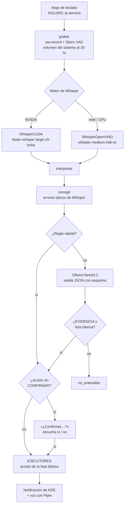
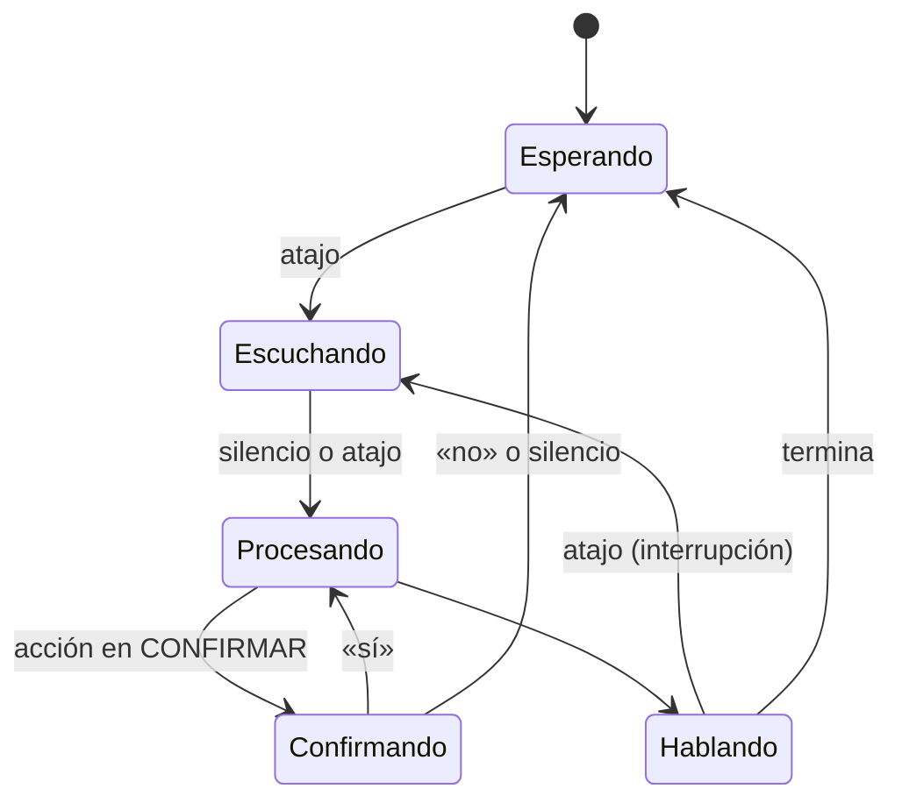

# Arquitectura

Cómo funciona el asistente por dentro: desde que pulsas el atajo hasta que responde. Todo el código está en `asistente.py`; los nombres entre `comillas` son funciones o constantes de ese archivo.

## Visión general

El asistente es un **servicio de usuario de systemd** (`systemd/asistente-voz.service`) que carga los modelos una vez y espera. El atajo de KDE ejecuta `systemctl --user kill -s USR1 …`, y la señal despierta el bucle principal.

## Componentes

### Configuración

- `config.json` (local, no se sube) se lee al arrancar en `CFG`. `config.example.json` es la plantilla.
- `validar_config()` avisa en el log de claves desconocidas (`CLAVES_CFG`), carpetas o archivos que no existen y una terminal no instalada. No detiene el arranque.

### Audio y detección de voz

`grabar()` lee bloques de 512 muestras (32 ms a 16 kHz) de `pw-record`:

1. Baja el volumen del sistema al 20 % para que la música no tape la voz. Guarda el volumen anterior en `$XDG_RUNTIME_DIR/asistente-voz-volumen`, por si el servicio muere a mitad (`_restaurar_volumen()` lo recupera al arrancar).
2. Cada bloque pasa por **Silero VAD** (`SileroVAD`, ONNX en CPU). Con probabilidad ≥ 0,5 es voz. Si el modelo no está, usa un umbral de volumen (RMS) calibrado con el ruido de los primeros 0,3 s.
3. Termina tras 1 s de silencio (`SILENCIO_FIN`), si no empiezas a hablar en 5 s (`ESPERA_INICIO`) o a los 15 s (`MAX_GRABACION`). Una segunda pulsación del atajo corta la grabación.
4. Avisa en el log si más del 0,5 % de las muestras está saturado (ganancia del micrófono demasiado alta).

Las últimas 10 grabaciones quedan en `grabaciones/` para diagnosticar (`guardar_grabacion()`).

### Voz a texto (Whisper)

Dos motores con la misma interfaz `transcribir(audio, pista) -> (texto, idioma)`:

| | `WhisperCUDA` | `WhisperOpenVINO` |
|---|---|---|
| Hardware | GPU NVIDIA (CPU int8 si CUDA falla) | GPU/NPU Intel o CPU |
| Modelo | `large-v3-turbo`, `int8_float16` | `whisper-medium-int8-ov` |
| Idioma | Detecta y elige el más probable entre `IDIOMAS` | Detecta libremente; devuelve `None` |
| Dependencias | `requirements-nvidia.txt` | `requirements-intel.txt` |

`motor_whisper()` elige `cuda` si `faster_whisper` está instalado (lo decide `instalar.sh` según la GPU). CTranslate2 necesita CUDA 12 y cuDNN 9, que vienen en paquetes de pip dentro del `venv`. `preparar_cuda()` añade sus carpetas a `LD_LIBRARY_PATH` y **se vuelve a ejecutar a sí mismo**, porque esa variable solo se lee al arrancar el proceso.

`pista_whisper()` genera en cada grabación una lista de términos (apps y nombres de tus proyectos) que se pasa como `initial_prompt`. Tiene que ser una lista y no frases: con frases de ejemplo, Whisper corta las transcripciones.

### Interpretación

`interpretar(texto)` convierte la frase en `(accion, parametro)`. Prueba en este orden y se queda con la primera coincidencia:

1. **`corregir()`**: arregla errores recurrentes de Whisper al inicio de la frase (`ABRE_MAL_OIDO`: «Ahora», «Aure», «Avril» → «abre»; `CIERRA_MAL_OIDO`: «Sierra» → «cierra»). `app_en()` encuentra la app aunque Whisper repita palabras («Fire, Firefox»).
2. **Reglas especiales** escritas en `interpretar()`, que necesitan extraer partes de la frase: dictado, temporizador (`numeros_en_cifras()` convierte «cinco minutos» → «5 minutos»), puerto, git, terminal en un proyecto, logs y reinicio de contenedores.
3. **`REGLAS`**: las regex de cada acción del `REGISTRO_ACCIONES`, **en el orden del registro**.
4. **Reglas de respaldo**: volumen o brillo con número, escritorio N, búsqueda web, tareas, «abre el proyecto X», «abre X», «cierra X».
5. **Ollama** (`MODELO_COMANDOS`) con `PROMPT_COMANDOS` y un esquema JSON (`ESQUEMA`) que limita la acción a los nombres del registro.

La respuesta del LLM pasa por dos filtros:

- **Evidencia**: la frase normalizada tiene que cumplir la regex `EVIDENCIA` de esa acción. Si el modelo «adivina» `bloquear_pantalla` ante una frase sin sentido, se descarta.
- **Lista blanca del parámetro**: la app tiene que existir (`resolver_app`), el atajo estar en `ATAJOS_KWIN`, la tarea en `TAREAS`, el contenedor existir (`resolver_contenedor`).

### Ejecución

`ejecutar()` busca la función en `EJECUTORES` (generado del registro). Cada ejecutor recibe `(param, lang, m)`, donde `m` son los textos de `MSG[lang]`, y devuelve la frase que se dirá en voz alta ("" = solo sonido).

Los programas se lanzan con `lanzar()`, que los separa del servicio (`start_new_session`), o con `subprocess.run` si hay que esperar el resultado. Nunca se pasa texto del usuario a un shell: los comandos son listas de argumentos. Las excepciones son las **tareas** y el **comando de actualizar**, que vienen de tu `config.json` y se ejecutan en una terminal visible.

### Catálogo de aplicaciones

`cargar_apps()` lee los `.desktop` igual que el menú de KDE (incluidos los de Flatpak), más las herramientas de consola de `APPS_TERMINAL` que estén instaladas. Crea varias claves por app (nombre, nombre genérico, último segmento del id) y aplica `ALIAS_APPS`, que admite varios ids candidatos porque cambian entre distribuciones.

`resolver_app()` recarga el catálogo si cambió algo (`_firma_apps()`: fechas de las carpetas y de los `.desktop`, herramientas instaladas). Lo comprueba como mucho cada 2 s.

### Bucle principal y estados

- `Asistente._senal()` decide qué hace el atajo según el estado: interrumpe la voz (y marca `reescuchar`), corta la grabación o empieza a escuchar.
- Las pulsaciones mientras procesa se ignoran, salvo la que interrumpió la voz.
- Una confirmación sin respuesta queda pendiente 15 s: se puede contestar «sí» pulsando el atajo otra vez.

### Respuestas habladas

- `Voz.decir()` sintetiza la frase completa con Piper y la reproduce con `pw-play`.
- `Voz.decir_stream()` se usa para las preguntas: `ollama_stream()` entrega oraciones mientras el modelo genera, un hilo las sintetiza y el principal las reproduce. Rota 3 archivos WAV con una cola de 1, para no sobrescribir el que está sonando. Si se interrumpe, una señal propia de esa respuesta (`_cancelar_stream`) detiene al hilo aunque siga esperando a Ollama. Los errores del hilo (Ollama caído) se relanzan en el principal.
- Un `threading.Lock` evita que el aviso de un temporizador y una respuesta hablen a la vez.

## Archivos en disco

| Ruta | Qué es | ¿En git? |
|---|---|---|
| `config.json` | Tu configuración local | No |
| `venv/` | Entorno de Python 3.13 | No |
| `modelos/` | Whisper, voces de Piper, Silero VAD (~1–2 GB) | No |
| `grabaciones/` | Últimas 10 grabaciones | No |
| `$XDG_RUNTIME_DIR/asistente-voz*.wav` | Audio temporal de las respuestas | — |
| `$XDG_RUNTIME_DIR/asistente-voz-kwin.js` | Script de KWin para cerrar ventanas | — |
| `~/.config/systemd/user/asistente-voz.service` | Servicio, generado por `instalar.sh` | — |

## Capas de seguridad

1. **Lista blanca de acciones**: el LLM solo puede elegir nombres del registro (esquema JSON) y nunca escribe comandos.
2. **Evidencia por palabras clave** para cada acción que propone el LLM.
3. **Parámetros validados** contra lo que existe (apps, atajos, tareas, contenedores, proyectos).
4. **Confirmación por voz** para las acciones de `CONFIRMAR`.
5. **Contraseñas fuera**: `sudo` se escribe en una terminal visible (el asistente nunca la ve), y «lee lo que copié» no lee nada que parezca una contraseña (`parece_secreto()`).
6. **Sin red**, salvo la descarga inicial de modelos: Whisper, Ollama y Piper corren en local.
